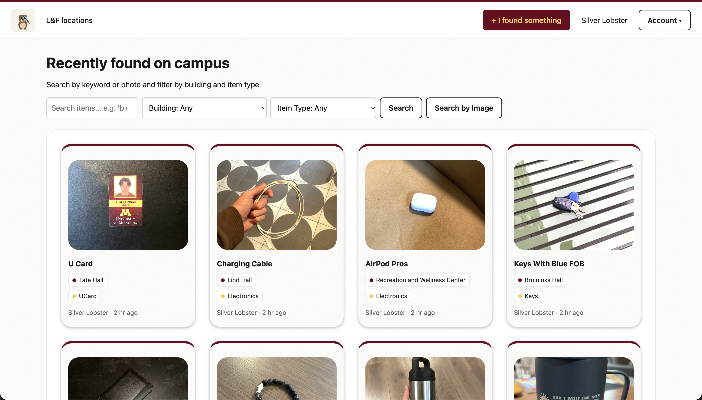
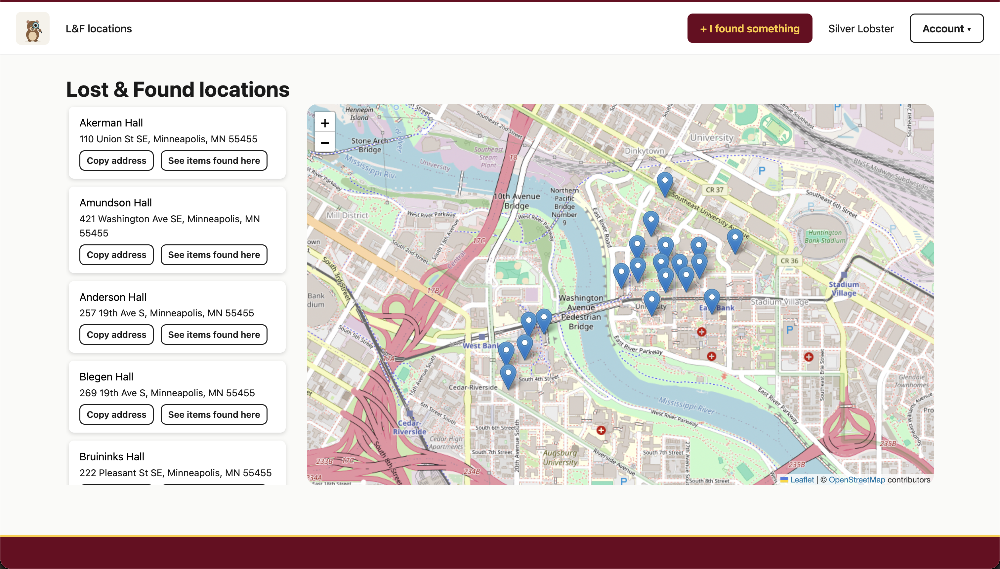
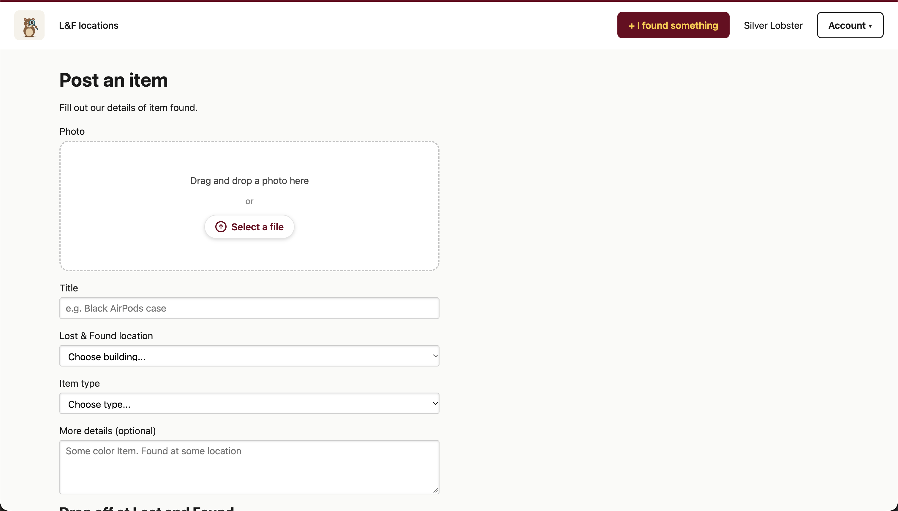
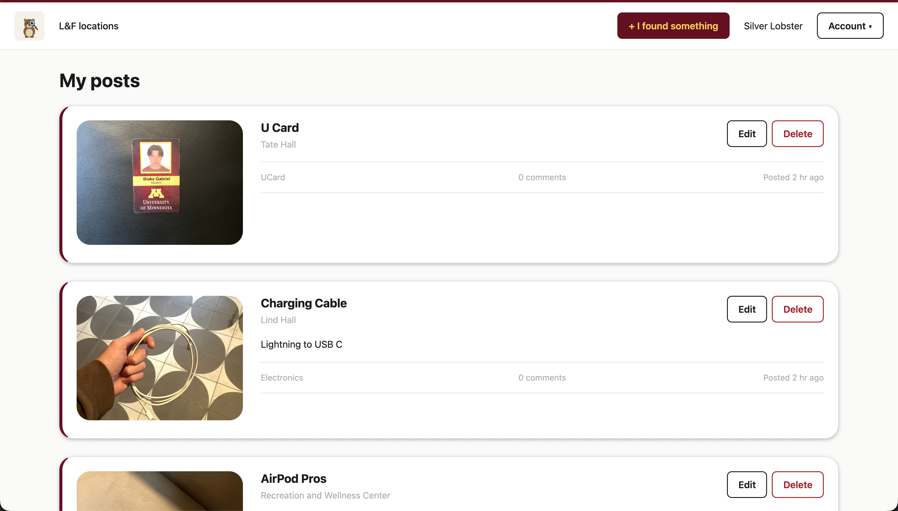
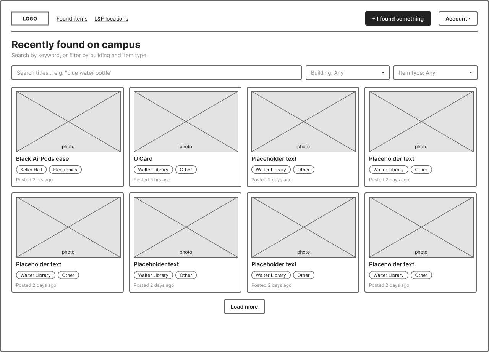
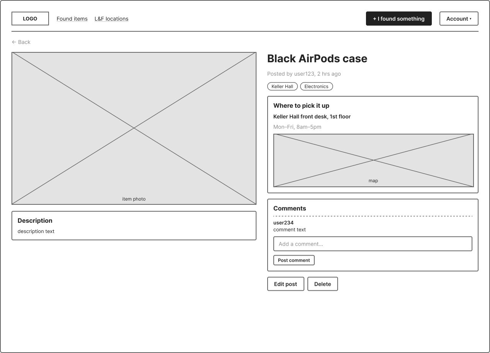
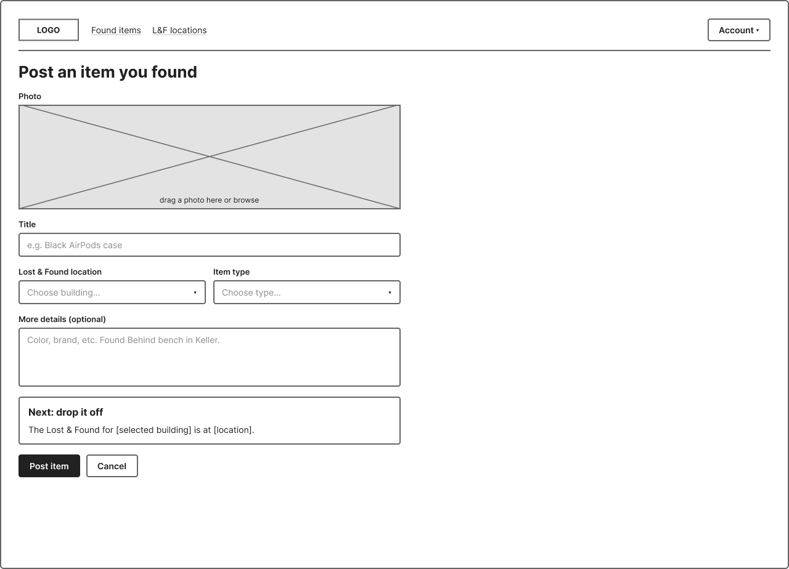
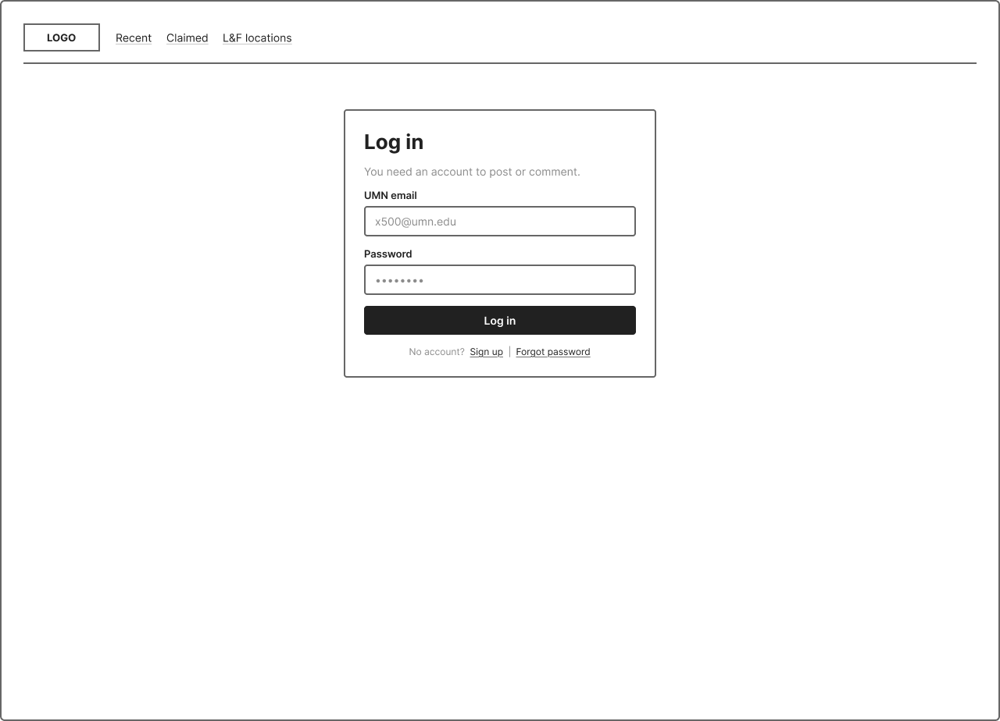
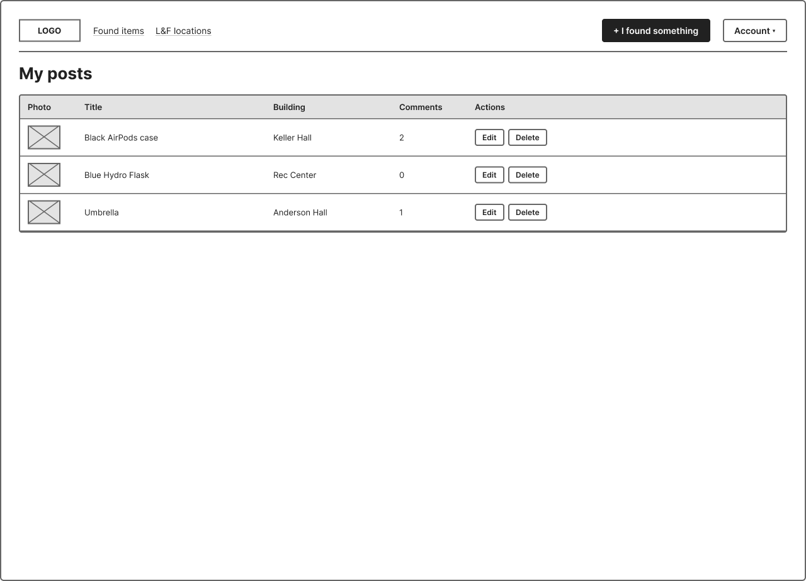

# Module 1 Group Assignment

CSCI 5117, Fall 2026, [assignment description](https://canvas.umn.edu/courses/579310/pages/project-1)

## App Info:

* Team Name: Yarakani
* App Name: Lost and Found
* App Link: [https://lost-and-found-88jm.onrender.com/](https://lost-and-found-88jm.onrender.com/)

### Students

* Nipun Bhatnagar, bhatn058@umn.edu
* Yassir Abdalla, abdal167@umn.edu
* Ray Amberg, amber079@umn.edu
* Kane Stirling, stirl027@umn.edu
* Blake Gabriel, gabri354@umn.edu

## Key Features

**Describe the most challenging features you implemented
(one sentence per bullet, maximum 4 bullets):**

* Login restriction that prevents non-UMN from registering with the site across email and Sign In With Google.
* Database pooling, mostly as a result of debugging the strange errors from gunicorn.
* Semantic search using text or image input using Open AI CLIP model. 
* Interactive Leaflet map of major campus Lost & Found locations, linked to each item's pickup location, with addresses stored in the database.

## Testing Notes

**Is there anything special we need to know in order to effectively test your app? (optional):**

* Must utilize a verified umn.edu email address to register.

## Screenshots of Site

### 1. Home page

*The main page of the site with recently posted items and the ability to search by keyword or photo and filter by building and item type.*

### 2. L&F locations

*Shows major campus lost and found locations on an interactive map with a list that allows the user to copy addresses and see items at that location. Clicking on a building from the list centers the map on that location.*

### 3. Post an item

*Users can create a post on this page with a photo, title, location, item type, and optional details.*

### 4. My posts

*Lists all of the user's posts so they can easily edit or delete them.*

## Mock-up 

### 1. Home page

*Main page most users will experience. Displays recently found items with filters for specific building and item types*

### 2. Item page

*Detail view for a single found item: photo, description, where to pick it up with a map image, and a comment section Edit and delet buttons only appear when the user is the original creator of the post*

### 3. Create post

*Form for creating a post including a generated textboc at the bottom prompting the user to drop off the item*

### 4. Log in

*Sign-in page restricted to umn email*

### 5. My posts

*A user's own posted items in a table, with comment counts and edit/delete actions for each one.*

## External Dependencies

**Document integrations with 3rd Party code or services here.
Please do not document required libraries. or libraries that are mentioned in the product requirements**

* Leaflet: interactive maps on he location and item pages
* OpenStreetMap: map tiles for Leaflet, plus the building addresses and coordinates
* Internal API: Hosted a local server to do CLIP inference since render peak ram limits were reached, clip_util shows exactly what functions are served by API. Branch DEMO-LOCAL-CLIP shows alternate implementation without using API however free tier render hosting would not work 

**If there's anything else you would like to disclose about how your project
relied on external code, expertise, or anything else, please disclose that
here:**

* Project uses CLIP by OpenAI (MIT License), see THIRD_PARTY_NOTICES.txt 
...
